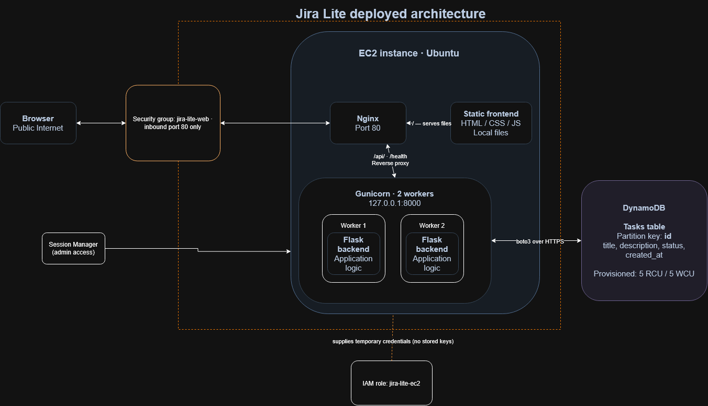

# Jira Lite

A small Kanban task board (To Do, In Progress, Done) running on a public Linux server in AWS. Anyone with the link can add, edit, move, and delete tasks, and they are saved in a database. The point of the project is the deployment: a Flask app behind Nginx and Gunicorn on an EC2 instance, with a real database, a health check that proves the database is reachable, and no stored credentials.

- **Live app:** http://3.138.189.117/ (plain HTTP; the address is auto-assigned, see [Known limitations](#known-limitations))
- **Health check:** http://3.138.189.117/health returns `{"database":"ok","status":"ok"}` when the app can reach DynamoDB, and a 503 when it cannot.

## Architecture



One request, end to end:

1. The browser sends `http://<public-ip>/` to the instance's public address.
2. The **security group** (an AWS firewall on the instance) allows only port 80 in.
3. **Nginx** listens on port 80. It serves the static page (`frontend/`) itself and forwards `/api/` and `/health` to Gunicorn.
4. **Gunicorn** runs two Flask worker processes. It listens on `127.0.0.1:8000` only, so nothing outside the machine can reach it directly.
5. **Flask** validates the request and calls DynamoDB through boto3.
6. The app gets AWS credentials from the **instance role**: temporary credentials that AWS supplies to the instance. No access keys are stored anywhere.
7. **DynamoDB** is a managed AWS service outside the instance. The answer goes back the same way.

Administration uses **AWS Systems Manager Session Manager**, a browser-based shell that needs no open SSH port and no key pair.

## Main choices and the alternatives I considered

The reasoning for each is in [architecture-decisions.md](architecture-decisions.md).

| Choice | What I picked | Alternative I did not pick |
| --- | --- | --- |
| Compute | One `t3.micro` EC2 instance, Standard CPU credits | A non-burstable M-family instance (oversized for this app) or another burstable family such as ARM T4g. I compared these at the family level, not by benchmark |
| Operating system | Ubuntu Server LTS (the instance runs 26.04.1) | Amazon Linux 2023 (I know Ubuntu and APT, so setup and troubleshooting are faster) |
| Database | DynamoDB | RDS, or PostgreSQL on the instance. DynamoDB has no database password to store and no database port to open, because access goes through an IAM role |
| Serving | Nginx in front of Gunicorn and Flask | Apache with `mod_wsgi`, or Gunicorn exposed directly |
| Admin access | Session Manager | SSH with keys and an open port 22 |
| Process management | systemd, deployed with a short script | Docker, or `nohup`/`screen` (do not survive a reboot) |
| Public address | The instance's auto-assigned public IP | An Elastic IP (stable address, but a recurring cost for a small demo; see limitations) |
| Frontend | One static page of plain HTML, CSS and JavaScript | React or Vue (a toolchain this page does not need) |

## Run it locally

You need Python 3.12 or newer and Docker. (I develop in Ubuntu under WSL.)

```bash
git clone https://github.com/RileyHop1/jira-lite.git
cd jira-lite
python3 -m venv .venv
. .venv/bin/activate
pip install -r requirements-dev.txt

pytest                  # the tests (no AWS calls)
ruff check              # lint, including docstrings
ruff format --check     # formatting

scripts/run-local.sh    # DynamoDB Local in Docker + the app on http://127.0.0.1:8000
```

`scripts/run-local.sh` starts DynamoDB Local (a copy of DynamoDB that runs in Docker, with no AWS account), creates the table, and runs Gunicorn with two workers, as on the server. Flask serves the page itself locally because there is no Nginx. DynamoDB Local does not check IAM permissions, so those are only proven on the real instance.

## How it was deployed

I created the AWS resources by hand in the console (there is no infrastructure-as-code). Region: `us-east-2`.

| Resource | Settings |
| --- | --- |
| DynamoDB table `jira-lite-tasks` | Partition key `id` (string), provisioned 5 read / 5 write units, auto scaling off |
| IAM policy `jira-lite-dynamodb` | Allows only `GetItem`, `PutItem`, `UpdateItem`, `DeleteItem` and `Scan` on that one table |
| IAM role `jira-lite-ec2` | Trusted by EC2; has `AmazonSSMManagedInstanceCore` and `jira-lite-dynamodb` |
| Security group `jira-lite-web` | One inbound rule: HTTP (port 80) from anywhere. No SSH |
| EC2 instance `jira-lite-server` | `t3.micro`, Ubuntu Server 26.04.1 LTS, 16 GiB `gp3`, Standard CPU credits, instance profile `jira-lite-ec2`, no key pair, default VPC with a public subnet |

**First deploy** (in a Session Manager shell on the instance):

```bash
sudo apt update && sudo apt install -y nginx python3-venv git
sudo git clone https://github.com/RileyHop1/jira-lite.git /opt/jira-lite/app
COMMIT=$(sudo git -C /opt/jira-lite/app rev-parse HEAD)
sudo /opt/jira-lite/app/deploy/deploy.sh "$COMMIT"
```

**Every later deploy:**

```bash
sudo git -C /opt/jira-lite/app fetch -q origin
COMMIT=$(sudo git -C /opt/jira-lite/app rev-parse origin/main)
sudo /opt/jira-lite/app/deploy/deploy.sh "$COMMIT"
```

`deploy/deploy.sh` checks out exactly that commit, creates the `jira-lite` service user and virtual environment if missing, installs the pinned requirements, installs the Nginx site and the systemd unit, runs `nginx -t` so a bad config stops the deploy, restarts the service, and then calls `/health` through Nginx. It only reports success if that returns 200. It is safe to run repeatedly.

**Rollback:** the script prints the previous commit when it starts. Run the same command with that commit.

## Operating it

Run these in a Session Manager shell:

| Task | Command |
| --- | --- |
| Status | `systemctl status jira-lite nginx` |
| Restart the app | `sudo systemctl restart jira-lite` |
| Stop / start the app | `sudo systemctl stop jira-lite` / `sudo systemctl start jira-lite` |
| App logs | `sudo journalctl -u jira-lite -n 50` |
| Nginx errors | `sudo tail -n 50 /var/log/nginx/error.log` |
| Health from the instance | `curl -s http://127.0.0.1/health` |
| What is listening | `sudo ss -tlnp` |

The service starts at boot and restarts itself after a crash. Troubleshooting history is in [docs/troubleshooting-log.md](docs/troubleshooting-log.md).

## Security

- Only port 80 is open to the internet. There is no SSH, no key pair, and Gunicorn listens on loopback only.
- The app runs as a no-login `jira-lite` user. The code is owned by root, so the running app cannot change its own files.
- AWS credentials come from the instance role and are temporary. The role can touch only this table, and only the five operations the app needs.
- No secrets are in the repository. Keys, `.env` files, and virtual environments are ignored.
- Input is validated on the server (titles up to 200 characters, descriptions up to 2,000, three allowed statuses), and Nginx rejects request bodies over 64 KB.
- Task text is shown on the page with `textContent`, never as HTML, so a task cannot run as code in another visitor's browser.
- `main` is protected: every change goes through a reviewed pull request.

## What is verified

| Check | Status |
| --- | --- |
| `/health` answers from the public internet and reaches DynamoDB | Verified 2026-11-02 and again 2026-11-04 |
| Board page, API, and static files served through Nginx | Verified 2026-11-04 |
| Over-limit input refused by the live site (201-character title, 2,001-character description, 100 KB body) | Verified 2026-11-04 |
| Tests (`pytest`) and lint (`ruff`) | Pass locally on Python 3.12; not run on the server's Python 3.14 |
| Tasks survive a service restart, a reboot, and a stop/start | Not yet verified |
| `/health` returns 503 when database access is denied | Not yet verified |
| Only port 80 inbound and Gunicorn on loopback, checked on the instance | Not yet verified |

## Cost

Not yet recorded. Real charges, remaining credits, and the budget settings will be added after checking Billing.

## Known limitations

- **HTTP only.** There is no HTTPS, so traffic is not encrypted and browsers mark the page "not secure". The data is demo data only.
- **No login.** Anyone with the link can add, change, or delete any task.
- **No rate limiting and no cap on the number of tasks.** Writes are limited by the table's provisioned capacity (a flood is throttled and returns a 503, not a bill), but someone could still fill the board.
- **`Scan` reads the whole table.** That is fine for one small board and would not be at scale.
- **One instance, no backups, no monitoring.** If the instance fails, the app is down.
- **The public address is auto-assigned.** It stays the same through a reboot but changes if the instance is stopped and started. I chose not to pay for an Elastic IP on a project this small, so the instance should be left running while the review is in progress.
- **Local and server Python differ** (3.12 locally, 3.14 on the server).
- **Resources were created by hand in the console**, so they are not reproducible from code.
- **Last write wins** when two people edit the same task at once.

## What I would change before real customers

HTTPS with a domain name, login and per-user permissions, a load balancer with more than one instance, automated deployment from CI with tests on every pull request, monitoring and alerts, DynamoDB backups, rate limiting, and infrastructure as code so the environment can be rebuilt from the repository.
